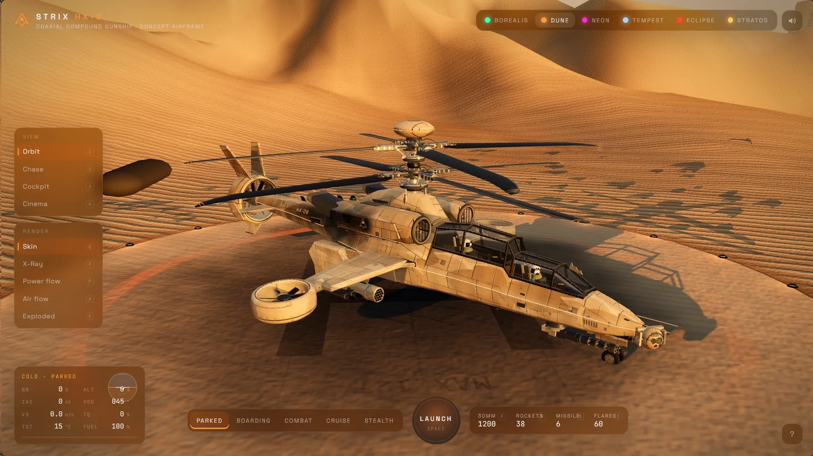

# Waggles

Interactive browser demos by [thtbee_](https://x.com/thtbee_) on 𝕏

**[thtbee.github.io/waggles](https://thtbee.github.io/waggles/)**

---

## About

Waggles is an ongoing collection of standalone browser experiments: 3D scenes, simulations, interfaces and anything else worth playing with.

Each demo lives in its own folder with its own code and README, so any one of them can be read, run or reused on its own. The gallery at the root links them together.

---

## Demos

### 001 · STRIX HX-9

<a href="https://thtbee.github.io/waggles/strix-hx9/"></a>

A real-time 3D concept gunship. Launch it, fly it and fire its cannon, rockets and missiles, then switch to x-ray, power-flow, airflow or exploded views to see how it is put together. Six environments, from an arctic fjord under the aurora to a rain-soaked neon city.

| | |
| --- | --- |
| **Play** | [thtbee.github.io/waggles/strix-hx9](https://thtbee.github.io/waggles/strix-hx9/) |
| **Folder** | [`strix-hx9/`](strix-hx9/) |
| **Built with** | Three.js, WebGL, Web Audio |

---

## Layout

```
waggles/
├── index.html        Gallery page
├── assets/           Gallery styles, icon and demo previews
├── strix-hx9/        Demo 001
└── tools/serve.py    Local server
```

Every demo follows the same rules:

- One top-level folder per demo, with an `index.html` at its root
- Self-contained: no shared code between demos, and only relative paths inside each one
- Its own README covering how to run it

---

## Desktop first

Phone layouts weren't a priority, so the demos play best in a desktop browser.

---

## License

© 2026 [thtbee_](https://x.com/thtbee_) · [CC BY-NC 4.0](LICENSE)

You're free to share and adapt anything here for non-commercial use, as long as you credit thtbee_ and link back to this repo. Commercial use is not permitted.
